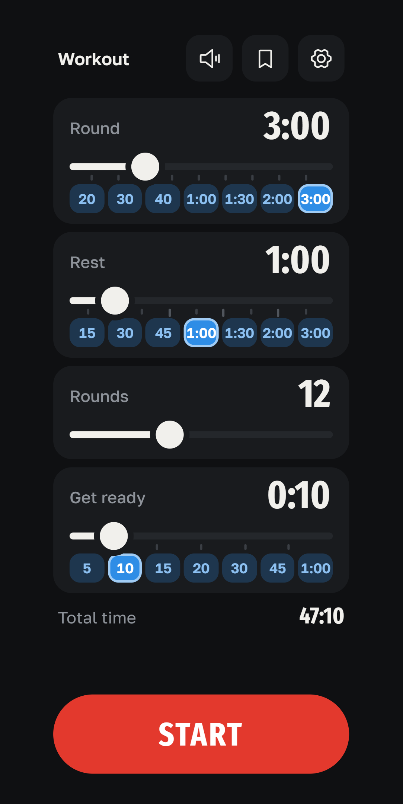
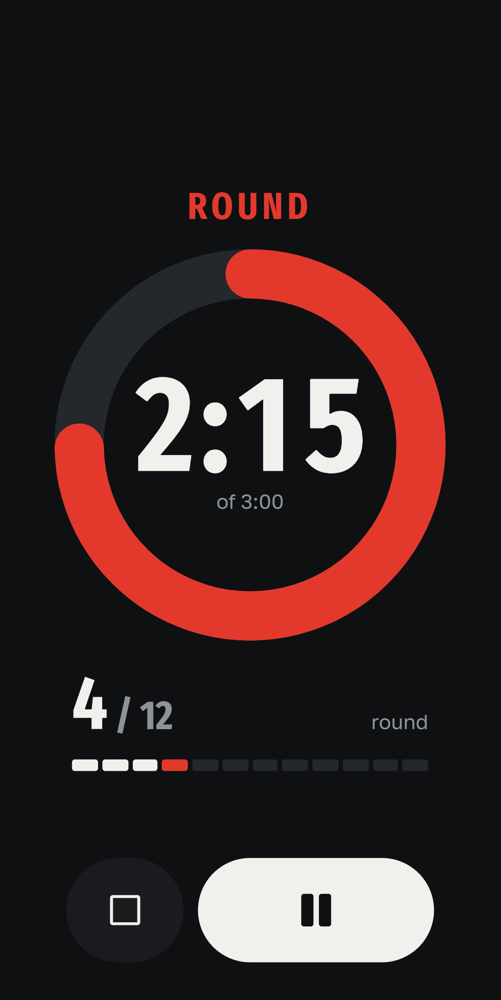
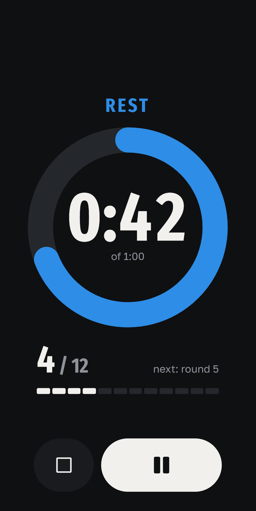
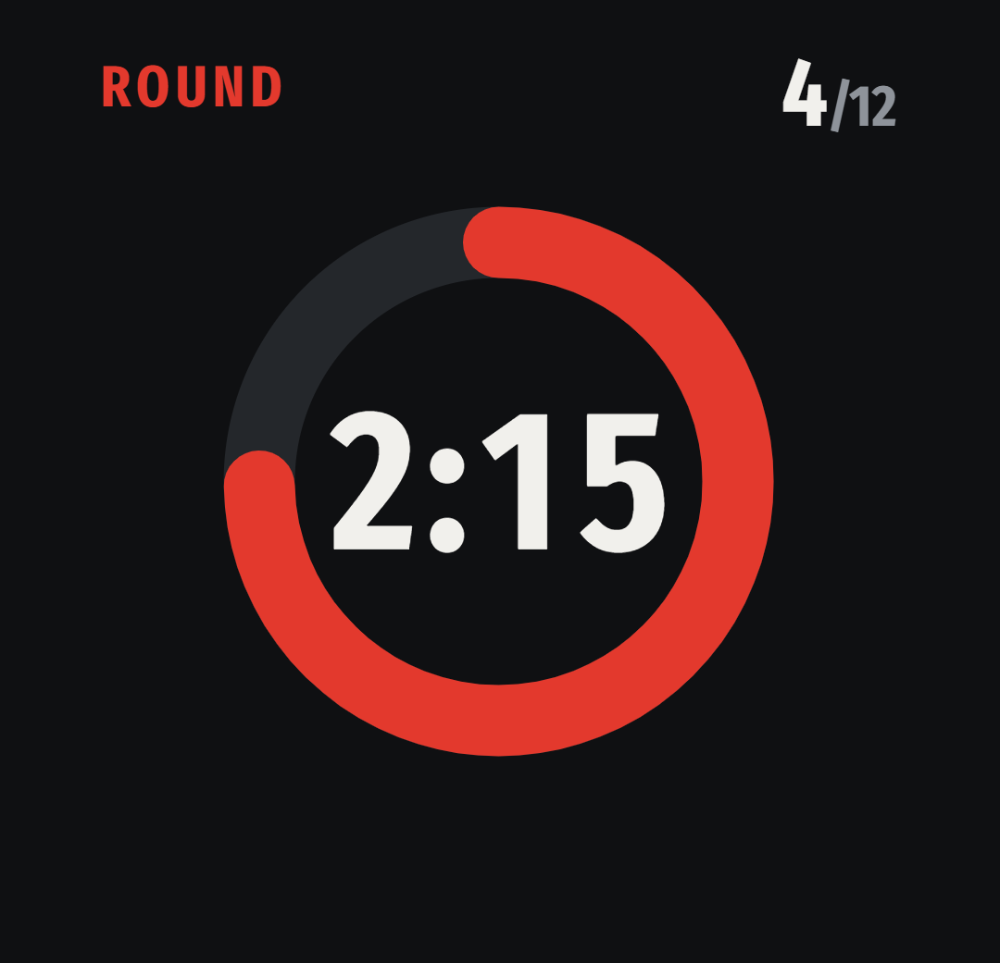

# Dumb Boxing Timer

A fully customizable boxing timer for Android. As simple as it gets: no clutter, no ads, no accounts, no internet access. Made with the Galaxy Z Flip cover screen in mind.

<p>




</p>

## Features

- Any round, rest and get-ready time, from seconds to hours
- Five presets; a preset can keep its own full settings
- Interval beep, warning before the end of a round, countdown for the last seconds
- A separate sound for each event, or your own sounds from the phone
- Ring only or the whole screen in the phase color; any color can be changed; 7 fonts for the digits
- Runs on the cover screen of a closed Galaxy Z Flip; landscape layout on the main screen
- English, Russian, Spanish, Chinese

## How it is built

The app is a single HTML page in an Android WebView.

| Path | What it is |
|---|---|
| `concepts/prototype-A.html` | The source of truth: screens, settings and the timer engine. Opens in a desktop browser as a design board with phone and cover-screen frames. |
| `app/build_web.py` | Builds `app/web/index.html` from the prototype: takes the app styles, data, screens and engine, drops the design board. |
| `app/web/` | The page shipped inside the app, with local fonts and Phosphor icons. |
| `app/android/` | The Android wrapper (Java, no AndroidX): a WebView that loads `index.html` from assets, plus vibration and keep-screen-on. |
| `store/` | Google Play listing texts, privacy policy, icon, feature graphic and screenshots. `make_screenshots.mjs` renders screenshots from `app/web/index.html` with headless Chrome. |

## Build

1. Build the page (Python 3):

   ```
   python app/build_web.py
   ```

2. Build the APK (Gradle 8.x, JDK 17, Android SDK with platform 36):

   ```
   cd app/android
   gradle assembleDebug
   ```

   The APK is in `app/android/app/build/outputs/apk/debug/`.

A release build is signed with the key from `app/android/keystore/keystore.properties`. The key is not in the repository; without it the release build is unsigned.

To try the page without Android, serve `app/web` with any static server and open `index.html`:

```
python -m http.server 8765 --directory app/web
```

## Gong sounds

The Google Play version has two extra sounds, Gong 1 and Gong 2, from [Zvukipro.com](https://zvukipro.com). The site does not allow redistributing its files, so they are not in this repository. `build_web.py` picks them up from `concepts/sounds/gongs.js` if that file exists. Without it the app builds without these two sounds and uses its own synthesized gong and bell by default.

## License

The code is under the [MIT License](LICENSE). Fonts and icons keep their own licenses, see [THIRD_PARTY_NOTICES.md](THIRD_PARTY_NOTICES.md).
